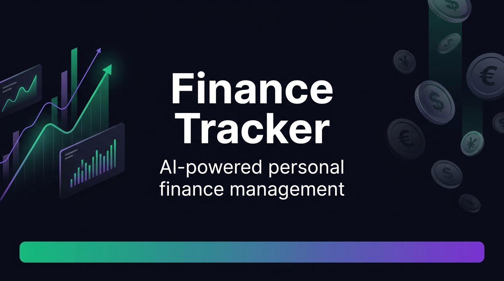

<div align="center">
  

  **Alpha — Personal Finance Tracker & Wealth Engine**

       

  Language: [Indonesia](README.md) · **English**
</div>

Personal finance, investment portfolio, and intelligent AI analytics platform built on a microservices topology. Features multi-profile ledger management, real-time multi-asset FIFO tracking (stocks, crypto, gold), an ensemble OCR receipt scanner, genetic portfolio optimization, ML predictive models, and weekly rotating self-rewards paired with behavioral finance indicators.

## Key Features

- **Ledger & Budgeting** - multi-account tracking, custom categories, expense and income logging, recurring transactions, safe-to-spend estimations, and future balance forecasting.
- **Portfolio & Investments** - comprehensive asset management (IDX stocks, crypto, gold) with automatic FIFO P/L calculation, dividend transaction history, and benchmark performance metrics.
- **Market Analytics & ML** - real-time technical indicators, XGBoost Sniper predictive models, genetic algorithm portfolio weight optimization, and Agent Senate consensus voting.
- **Insights & Receipt OCR** - 3-engine ensemble receipt parsing (Tesseract + EasyOCR + PaddleOCR) with majority voting, automated anomaly detection, and an AI financial health score.
- **Rewards & Gamification** - weekly rotating self-rewards (12 items from a curated 300+ item bilingual pool, 5 categories, 25 price tiers), 14-day carry-over claim window, saving streak tracking, and discipline ranks.
- **Platform & Security** - isolated multi-profile support (Personal & Business), CIA Triad authentication with HMAC request signing, per-IP rate limiting, SQLite audit logging, and Telegram bot notifications.

## System Architecture

Distributed microservices topology featuring a unified API Gateway that routes requests across six independent domain services:

```text
                       ┌──────────────┐
   Browser / Web ─────►│   Gateway    │ :8444  Exact-route reverse proxy
   CLI / Mobile ──────►│  (FastAPI)   │        built from OpenAPI specs
                       └──────┬───────┘
      ┌──────────┬───────────┬┴─────────┬────────────┬────────────┐
      ▼          ▼           ▼          ▼            ▼            ▼
   platform    ledger    portfolio    market     insights    engagement
    :8450      :8451       :8452       :8453       :8454       :8455
   Auth & Core Transaction Investments Stock Market Receipt OCR Behavioral
   Profiles    Budgets     FIFO P/L    ML Models   AI Advisor  Reward Pool
   Telegram    Forecast    Reports     Optimizer   Anomalies   Weekly Rotation
      └──────────┴───────────┴──────────┬─┴────────────┴────────────┘
                                        ▼
                                 PostgreSQL 16
```

| Service | Port | Domain & Responsibilities |
|---|---|---|
| `gateway` | 8444 | Public entry point, automatic HTTP reverse proxy, WebSocket proxy (`/ws/*`) |
| `platform` | 8450 | Authentication, profile management, audit logging, WebSocket alerts, Telegram bot |
| `ledger` | 8451 | Expenses, income, categories, budgeting, safe-to-spend, balance forecasting |
| `portfolio` | 8452 | Multi-asset investments, FIFO P/L calculations, dividend summaries, dashboard feeds |
| `market` | 8453 | Stock indicators, XGBoost ML models, genetic optimizer, Agent Senate, market scheduler |
| `insights` | 8454 | Ensemble receipt OCR scanning, merchant mapping, spending anomaly detection |
| `engagement` | 8455 | Financial Behavioral Score (FBS), weekly self-reward rotation, carry-over claims |

## Tech Stack

| Layer | Technology |
|---|---|
| Frontend | [Next.js](https://nextjs.org) 15 (Canonical) + [Vite](https://vite.dev) 5 / [React](https://react.dev) 19, Tailwind CSS, Recharts, ID/EN Context i18n |
| Backend | Python 3.12, [FastAPI](https://fastapi.tiangolo.com), Uvicorn, Pydantic v2, HTTPX, Prisma Client Python |
| Analytics & ML | pandas, NumPy, yfinance, XGBoost, Genetic Algorithm, Ollama (optional) |
| Receipt OCR | Ensemble [Tesseract](https://github.com/tesseract-ocr/tesseract) + [EasyOCR](https://github.com/JaidedAI/EasyOCR) + [PaddleOCR](https://github.com/PaddlePaddle/PaddleOCR) |
| Database | [PostgreSQL](https://www.postgresql.org) 16 (isolated multi-profile schemas) + local SQLite |
| Orchestration | [Turborepo](https://turbo.build), pnpm 11, Docker Compose, Kubernetes (`k8s/`) |

## Directory Structure

```text
personal-finance-tracker/
├── apps/
│   ├── web/                 # Canonical Next.js 15 dashboard (App Router, Tailwind, TypeScript)
│   ├── cli/                 # Interactive Textual (Rich) terminal TUI
│   └── api/                 # Legacy monolith wrapper (backward-compatible)
├── packages/
│   ├── api/                 # Shared backend library: routers, CIA security, automation
│   ├── core/                # Clean Architecture: domain, application services, infrastructure
│   │   ├── domain/          # Business entities, reward engine, mathematical models
│   │   ├── application/     # Use cases: ledger, portfolio, insights, OCR
│   │   └── infrastructure/  # PostgreSQL repositories, 300-item reward pool seeder
│   ├── database/            # Prisma schema & migration bridge
│   ├── types/               # Shared TypeScript definitions
│   └── web/                 # Legacy Vite web application (React 19, ID/EN i18n)
├── services/                # Canonical Microservice Runtime
│   ├── gateway/             # Reverse proxy gateway (:8444)
│   ├── platform/            # Platform & user service (:8450)
│   ├── ledger/              # Transaction & budget service (:8451)
│   ├── portfolio/           # Investment & report service (:8452)
│   ├── market/              # Capital market & ML service (:8453)
│   ├── insights/            # Receipt OCR & analytics service (:8454)
│   ├── engagement/          # Reward & weekly rotation scheduler service (:8455)
│   └── runtime/             # Shared bootstrap, logging, circuit breaker, rate limiter
├── migrations/              # Numbered SQL schema migrations (001–021)
├── k8s/                     # Kubernetes manifests: gateway, domain-services, ingress
├── scripts/                 # Administration utilities & 26-week rotation simulation
├── docker-compose.yml       # Development Docker topology
├── docker-compose.prod.yml  # Production Docker topology
└── README.md
```

Browse the code: [services](services/) · [packages](packages/) · [apps](apps/) · [migrations](migrations/) · [k8s](k8s/)

## Run (Development)

Prerequisites: Python 3.12+, Node.js 20+ (22 recommended), pnpm 11, PostgreSQL 16 (or Docker).

### Option A — Docker Compose (Full Topology)

```bash
# Copy environment configuration
cp .env.example .env

# Start all services, gateway, database, and web frontend
docker compose up --build

# Access endpoints:
# Web Dashboard  → http://localhost:3000
# API Gateway    → http://localhost:8444  (Health check: http://localhost:8444/health)
```

### Option B — Local without Docker

```bash
# 1. Install workspace dependencies (frontend & tooling)
pnpm install

# 2. Install Python dependencies
pip install -r requirements.prod.txt

# 3. Launch all microservices + gateway
# Windows:
./run-services.bat
# Linux/macOS: run python -m services.<service_name>.main in separate terminals

# 4. Launch frontend (separate terminal)
pnpm --filter @finance-tracker/web dev    # Canonical Next.js dashboard (:3000)
# or
pnpm --filter finance-tracker-gui dev    # Legacy Vite dashboard (:5173)
```

## Verification & Testing

```bash
# Run all Python unit test suites
pytest tests/unit/

# Run 26-week reward rotation simulation
python scripts/simulate_rotation.py

# Verify frontend TypeScript compilation
pnpm --filter @finance-tracker/web exec tsc --noEmit

# Verify legacy frontend build
pnpm --filter finance-tracker-gui build
```

## License

`MIT LICENSE` (Copyright © 2026 Zhvny).
