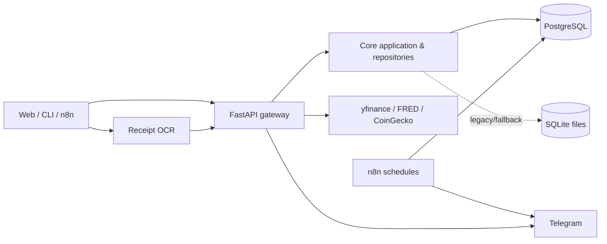
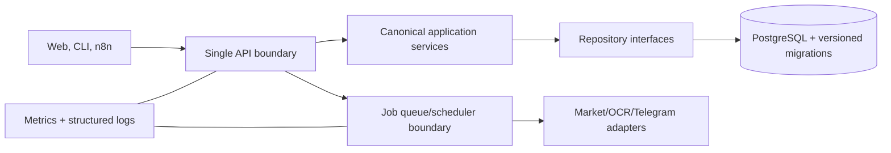

# DEEP CODE REVIEW — Alpha (Working Tree)

**Tanggal:** 2026-08-08  
**Cakupan:** seluruh working tree yang tersedia, termasuk perubahan belum di-commit.  
**Batasan:** review statis dan validasi lokal non-destruktif. Python/`pytest` tidak tersedia pada `PATH`, sehingga hasil test runtime tidak dapat dikonfirmasi pada environment ini.

---

## A. EXECUTIVE SUMMARY

Alpha adalah modular monolith untuk personal finance, investasi, analisis saham/ML, OCR kuitansi, dan notifikasi. Working tree mencakup FastAPI, Next.js, CLI Python, PostgreSQL/SQLite, Prisma, n8n, serta integrasi Telegram dan data pasar.

**Kesimpulan:** produk memiliki cakupan fitur dan test suite yang substansial, tetapi belum production-ready untuk data finansial tanpa remediasi P0. Risiko tertinggi bukan kurangnya fitur, melainkan ketidakjelasan sumber kebenaran data, fallback database yang dapat mengubah media penyimpanan setelah error, serta hygiene konfigurasi/deployment.

| Priority | Finding | Severity | Outcome bila tidak diperbaiki |
|---|---|---|---|
| P0 | PostgreSQL failure falls through to SQLite | CRITICAL | write/read dapat tidak konsisten antar-store |
| P0 | Default secret dan kredensial DB tersedia pada konfigurasi | HIGH | deployment salah konfigurasi mudah terekspos/diambil alih |
| P1 | Schema contract tersebar (Prisma, initializer, SQL n8n, SQLite) | HIGH | migrasi dan data profile mudah drift |
| P1 | Runtime artifacts/log/cache/model berada di source tree | HIGH | repository bloat, data leakage, reproduksibilitas lemah |
| P1 | Startup melanjutkan layanan setelah kegagalan dependency utama | HIGH | API dapat menyajikan hasil parsial/stale |

Hal yang **tidak diklaim**: tidak ada exploit eksternal yang dijalankan, tidak ada audit dependency online, dan tidak ada bukti secret aktual disalin ke laporan ini. Vulnerability berbasis versi dependency atau konfigurasi production aktual: **Cannot confirm from the available source code.**

## B. PROJECT UNDERSTANDING

### Tujuan dan pengguna

Alpha mendukung pengguna individual/retail investor (terutama IDR) untuk mencatat expense, income, investasi, dan receipt; menganalisis saham/crypto; serta menerima alert kurs/harga. Terdapat konsep profile personal/business dan UI web modern selain CLI.

### Fitur dan data flow

### Stack dan struktur

- `apps/api`: FastAPI bootstrapping, scheduler, router registration.
- `packages/api/backend`: routers, security, automation, service integration.
- `packages/core`: domain/application/repository layer.
- `apps/cli`: finance workflow, OCR, stock analysis, ML/TUI.
- `apps/web`: Next.js; `packages/web`: Vite/React legacy implementation yang masih ada.
- `packages/database/schema.prisma`, `alpha_db_schema.sql`, dan initializer runtime: beberapa definisi skema.

## C. ARCHITECTURE ANALYSIS

**Current state:** modular monolith adalah pilihan yang tepat untuk domain dan ukuran tim saat ini; memecahnya menjadi microservice kini justru akan memperbesar masalah contract dan transaction boundary. Namun boundary internal belum tegas: API, CLI, core, SQLite legacy, PostgreSQL, Prisma, dan raw SQL semua memiliki jalur penyimpanan sendiri.

**OBSERVATION → EVIDENCE → ROOT CAUSE → TECHNICAL IMPACT → BUSINESS/USER IMPACT → RECOMMENDATION → PRIORITY**

1. **Postgres dapat diam-diam beralih ke SQLite.** Evidence: `packages/api/backend/infrastructure/database.py:137-143` menangkap setiap exception dari `DatabaseManager.execute(...)`, log error, lalu `pass`; kode kemudian mengeksekusi SQL ke SQLite pada `:144-149`. Root cause: fallback transparan dipakai sebagai availability mechanism. Impact: sebuah operasi gagal di Postgres tetapi sukses di SQLite berbeda; read berikutnya tergantung target path dan dapat berbeda. User dapat melihat saldo/holding tidak konsisten. Recommendation: hapus fallback untuk persistent financial writes; fail closed dengan error terstruktur dan transaction retry yang terbatas. Migrasikan legacy read-only secara eksplisit. **P0 / CRITICAL.**

2. **Sumber skema dan persistence terlalu banyak.** Evidence: `packages/database/schema.prisma:15-99` berisi model finance; `alpha_db_schema.sql:113-188` membuat tabel finance lain; `packages/core/infrastructure/config.py:181-190` mengembalikan tujuh SQLite database; `apps/api/main.py:79-91` juga menjalankan schema initializer saat startup. Root cause: migrasi bertahap tanpa satu migration authority. Impact: schema/profile/constraint/index dapat drift. Recommendation: pilih PostgreSQL+versioned migrations sebagai authority; dokumentasikan ownership tabel n8n; jadikan SQLite import/export sementara, bukan fallback. **P1 / HIGH.**

3. **Modular monolith perlu consolidation, bukan microservices.** Evidence: `apps/api/main.py:371-402` memuat router lewat daftar string dan `importlib`; domain implementation tersebar pada `apps/cli`, `packages/api`, dan `packages/core`; `packages/web` dan `apps/web` sama-sama frontend aktif dalam tree. Root cause: beberapa migrasi aplikasi berjalan bersamaan. Impact: import/path hack, contract ganda, dan testing lintas-layer lebih sulit. Recommendation: tetapkan canonical application service per bounded context dan ADR migrasi; deprecate package lama dengan tanggal/hapus setelah coverage parity. **P1 / HIGH.**

### Target architecture dan migration path

Migration: (1) freeze schema ownership and disable fallback writes; (2) move CLI to the same application services; (3) extract long-running market/OCR/ML jobs behind queue only when measured latency/retry needs justify it. Redis/cache is optional; introduce it only for measured hot market/OCR lookup paths, with TTL and invalidation ownership.

## D. SECURITY REVIEW

1. **Security defaults are unsafe for a production misconfiguration.** Evidence: `apps/api/config.py:24-29` supplies PostgreSQL credentials in `DATABASE_URL`; `:31` supplies `alpha-microservice-default-secret-key`; `packages/core/infrastructure/config.py:184-187` defaults Postgres user/password to `postgres`; development Compose embeds `POSTGRES_PASSWORD: password` at `docker-compose.yml:24-26`. Root cause: dev defaults share production code paths. Impact: an accidentally exposed production deployment may use known credentials/secret. Recommendation: require env secrets in production config validation; refuse startup when defaults are present; separate dev compose from prod secret injection. **P0 / HIGH (security improvement/confirmed insecure default, not a claim of exposure).**

2. **Authentication is present but single-key and dev bypass is operationally fragile.** Evidence: `security/core.py:219-245` bypasses auth when `FINANCE_TRACKER_DEV_MODE=1`; `:274-283` maps every valid key to `admin`. Root cause: single-user convenience model. Impact: no key rotation, identity, least privilege, or auditable actor. Recommendation: keep single-user scope if intended, but make dev mode impossible in production and use rotatable secrets; add identity only if multi-user is a product requirement. **P1 / HIGH.**

3. **Audit log is best-effort and local SQLite.** Evidence: `security/core.py:151-178` catches all audit errors and continues; `_AUDIT_DB` points to `packages/api/data/audit_log.db` (`:59`). Impact: accounting can silently disappear and container filesystem may be ephemeral. Recommendation: write structured audit events to durable Postgres/log sink, expose audit health, and alert on failures. **P2 / MEDIUM.**

4. **WebSocket token is accepted in query string.** Evidence: `routers/notifications.py:11-23` receives `token: Query(None)` and compares it. Query strings routinely appear in access logs/proxies/browser history. Recommendation: use an Authorization header or short-lived, one-time WS ticket; redact query strings at the edge. **P1 / HIGH.**

Positive controls: CORS is configured from an allow-list (`apps/api/main.py:169-175`); normal HTTP routers generally declare `require_scope`; comparison uses `hmac.compare_digest`; the API refuses requests if no key is configured and dev mode is off (`security/core.py:226-245`).

## E. DATA & DATABASE REVIEW

- Decimal/currency and investment correctness deserve the strongest invariant tests because silent fallback undermines repository guarantees.
- `Config.get_db_paths()` in `packages/core/infrastructure/config.py:181-190` makes profile storage file-based while API uses Postgres configuration, creating dual operational semantics.
- `alpha_db_schema.sql` mixes n8n history tables and financial application tables. This makes independent rollout/rollback ambiguous.
- No evidence was found of a single migration runner or migration history. **Cannot confirm from the available source code** whether production schema is aligned.

Recommendation: define a transaction boundary for expense/income/investment changes, apply DB constraints at the canonical store, use migration checks in CI, and make profile identity explicit in every canonical table/schema strategy.

## F. CODE QUALITY & MAINTAINABILITY

1. **Broad exception handling changes behavior, not merely logging.** Evidence: DB fallback described above; startup blocks in `apps/api/main.py:79-126` log `CRITICAL` errors for schema/Prisma/scheduler then continue to `yield`. Root cause: availability-oriented catch-all policy. Impact: partial system has no explicit readiness state. Recommendation: catch expected exceptions only, fail startup for required dependencies, and declare optional features separately. **P1 / HIGH.**

2. **Import/path compatibility shims conceal package topology issues.** Evidence: `apps/api/main.py:39-45` and `packages/api/api_server.py:14-17` mutate `sys.path`. Recommendation: package/install the monorepo properly and use one canonical Uvicorn entrypoint. **P2 / MEDIUM.**

3. **Working tree fails whitespace hygiene.** Evidence: `git diff --check` reports many trailing whitespace and a new blank line at EOF across source/tests/docs. Recommendation: pre-commit formatter/linter and CI gate. **P3 / LOW.**

## G. PERFORMANCE & SCALABILITY

- The in-memory rate limiter in `security/core.py:87-113` is per-process; it neither coordinates multiple Uvicorn workers nor bounds the number of unique-IP keys. Under scale it becomes inconsistent and may grow unbounded. Use an edge rate limiter or Redis only when multi-instance deployment is required. **P2 / MEDIUM.**
- `apps/api/main.py:105-115` starts market scheduler in-process. Multiple replicas would duplicate schedules unless deployment guarantees one replica. Use a single scheduler worker/leader lock before scaling. **P1 / HIGH.**
- ML/OCR/market calls are potentially long-running; separate job lifecycle, timeout, idempotency key, and status persistence before trying to scale workers. No measured benchmark conclusion is asserted here.

## H. TESTING & QUALITY ASSURANCE

The repository contains unit, integration, automation, regression, stability, and audit tests. This is a strength. However, no CI workflow file was found in the standard locations searched, and `pyproject.toml` defines coverage configuration without a required coverage threshold/report gate.

Validation attempted: `python -m pytest tests/unit/test_config.py tests/unit/test_financial_math_invariants.py tests/unit/test_income_logic.py -p no:cacheprovider -q`. It did **not** start because `python` is absent from `PATH`; this is an environment limitation, not an application test failure.

Prioritize deterministic tests for: Postgres failure must never create SQLite financial writes; migration parity; transaction rollback; scheduler single-instance; auth/dev mode; WebSocket credential redaction; and API/CLI contract parity. Run browser/OCR/network tests separately with explicit service fixtures.

## I. RELIABILITY & OPERATIONS

- `apps/api/Dockerfile` generates the Prisma client at container startup (`CMD`), making availability dependent on runtime generator/tool behavior instead of immutable image build artifacts. Build and validate it during image build, pin versions, and fail deployment earlier. **P2 / MEDIUM.**
- API starts Telegram polling as a background task and only cancels it on shutdown (`apps/api/main.py:118-126, 132-135`); task completion/failure is not supervised in the shown code. Add task supervision, health state, retry/backoff, and alerting. **P2 / MEDIUM.**
- HTTPS redirect is enabled only if local cert files happen to exist (`apps/api/main.py:163-166`). Terminate TLS explicitly at ingress/reverse proxy and enforce proxy headers/HSTS in production policy. **P2 / MEDIUM.**

## J. FRONTEND & UX LIMITATIONS

- Two frontend implementations (`apps/web` Next.js and `packages/web` Vite) create ambiguity over canonical route/API/error behavior. Consolidate before feature expansion.
- The front-end uses a single API key model; a public browser cannot safely treat a master key as a normal user credential. If web is remotely served, introduce a session/BFF design or a deployment boundary that makes this a trusted single-user local UI. **P1 / HIGH.**
- Accessibility/performance quality cannot be confirmed without building/running the UI. The tree includes audit tests, but no runtime result is asserted.

## K. DEPENDENCIES & SUPPLY CHAIN

- Python requirements exist in at least `apps/api`, `packages/api`, and CLI locations; no single lockfile for Python dependencies was evidenced. Reproducibility and CVE remediation are therefore weak. **P1 / HIGH.**
- The web Docker build uses `pnpm install --no-frozen-lockfile` (`apps/web/Dockerfile:17`), permitting lockfile mutation/resolution drift during builds. Use `--frozen-lockfile` in CI and production. **P1 / HIGH.**
- `npm audit`/online CVE status was not run, so no version vulnerability is asserted.

## L. REPOSITORY HYGIENE & DELIVERY RISK

The working tree is exceptionally dirty: numerous modified/deleted source files plus new Docker, schema, workflow, test, model, image, and log/cache assets. This review does not attribute those changes to the last commit.

Evidence: `git status --short` lists broad source and artifact changes; `git ls-files` includes `apps/cli/stock_analyzer/cache.db` and a very large collection of model JSON assets; working tree also contains `apps/api/alpha_microservice.log`, DB/cache files, generated bytecode, and image archives. `.gitignore` has useful exclusions but does not undo already tracked assets.

Recommendation: split source/config/docs from generated models, database/cache, log, and image fixtures; use release/model registry or artifact storage; add size and secret scanning gates. **P1 / HIGH.**

## M. PRIORITY MATRIX

| Priority | Deliverable | Impact | Effort | Dependencies |
|---|---|---:|---:|---|
| P0 | Remove DB fallback writes; canonical-store transaction/error contract | Very high | M | DB owner/migration plan |
| P0 | Production configuration validation; rotate/default-free secrets | Very high | S | deployment secrets |
| P1 | One schema migration authority + profile model | High | L | data migration/backups |
| P1 | Scheduler singleton and job reliability contract | High | M | deployment topology |
| P1 | Consolidate canonical web/service paths; WS credential redesign | High | M | frontend deployment choice |
| P1 | Lock dependencies and frozen builds; CI gates | High | S | CI platform |
| P2 | Durable audit, readiness, metrics/alerts | Medium | M | observability target |
| P3 | Formatting/pre-commit cleanup | Low | S | formatter choice |

## N. FIVE-PHASE ROADMAP

1. **Contain (week 1):** fail closed on Postgres writes; validate required secrets; prevent dev mode in production; remove WS query token. Success: failed DB write returns error and creates no alternate-store record.
2. **Make data authoritative (weeks 2–3):** schema inventory, versioned migrations, profile strategy, backup/restore rehearsal. Success: one canonical database contract and migration check.
3. **Make operations honest (weeks 3–4):** readiness/liveness, scheduler singleton, supervised jobs, durable audit logs. Success: dependency failures are visible and cannot masquerade as healthy service.
4. **Consolidate product paths (weeks 4–6):** select web frontend and canonical service layer; compatibility adapters with deprecation tests. Success: no new feature lands in legacy path.
5. **Institutionalize quality (ongoing):** CI lint/type/unit/integration tiers, coverage floor for financial core, locked dependencies, artifact policy. Success: merge gates reproduce builds and detect schema/security regressions.

Risks: data migration can expose existing drift; take backups and reconcile totals before cutover. Do not introduce queue/cache/microservices until phases 1–3 supply a stable correctness baseline.

## O. WHAT IS ALREADY GOOD

- Clear product-domain separation is visible in routers, core services, and specialized CLI modules.
- Security implementation uses constant-time key comparison and default CORS allow-list.
- Rate limiting, audit intent, scheduler shutdown, structured logging, ORM/schema files, Docker/Kubernetes/n8n artifacts, and broad test categories already exist.
- Documentation of workflows and product features is unusually rich for a project at this stage.
- Existing tests for financial math, profile isolation, optimizer behavior, OCR, and API flows provide a solid base once environment/CI is standardized.

## P. FINAL CRITICAL ASSESSMENT

Alpha should remain a **modular monolith**, but it needs a deliberate reliability pass before expanding feature scope or splitting services. The single most urgent correction is to make financial persistence authoritative: a PostgreSQL error must be observable and atomic, never converted into a different SQLite write path. The next urgent correction is production configuration discipline. Once those foundations are in place, schema consolidation, scheduler/job ownership, and CI will convert the project’s strong feature breadth into a system that can safely be trusted with financial records.

### Evidence index

- `packages/api/backend/infrastructure/database.py:137-152`
- `packages/core/infrastructure/config.py:181-190`
- `apps/api/config.py:24-43`
- `packages/api/backend/security/core.py:59, 151-178, 219-283`
- `packages/api/backend/routers/notifications.py:11-23`
- `apps/api/main.py:79-126, 163-176, 371-402`
- `apps/api/Dockerfile:37-43`; `apps/web/Dockerfile:17`
- `packages/database/schema.prisma:15-99`; `alpha_db_schema.sql:113-188`
