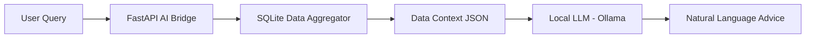

# 🧠 Feature: AI Financial Advisor (Local LLM)

The **AI Financial Advisor** is the intelligence layer of the ecosystem, designed to provide natural language insights and behavioral coaching while maintaining absolute data privacy via a **Local-First AI** architecture.

---

## 🏗️ Technical Architecture: Private RAG

Unlike traditional AI apps that send data to the cloud, this module uses a **Retrieval-Augmented Generation (RAG)** flow that never leaves your local machine.

### **1. The Core Components:**
- **Ollama Engine**: Runs the model (e.g., `llama3:8b` or `phi3:mini`) as a background service.
- **Context Bridge**: A specialized service that translates human questions into optimized SQL queries to fetch relevant financial snapshots.
- **Prompt Engineer**: A module that "wraps" your financial data into a safe, non-identifiable prompt for the LLM.

---

## 🧩 Deep Dive: Security & Privacy

### **No Data Leakage**
The integration uses a **Local API Loopback** (`localhost:11434`). No financial data, prompts, or logs are transmitted to external servers.

### **Context Stripping**
Before data is sent to the LLM, PII (Personally Identifiable Information) like specific account numbers or full names can be stripped, leaving only the numerical patterns and categories for analysis.

---

## 📊 Interaction Modes

### **1. Investigative Query**
*   **User**: "Why is my food spending 20% higher than last month?"
*   **AI**: Analyzes `expense.db` → Identifies 5 specific "GrabFood" transactions late at night → Suggests: "You have a pattern of late-night impulse orders. Reducing these could save you Rp 500k/month."

### **2. The Behavioral "Roast" (Optional)**
*   **User**: "Review my weekend."
*   **AI**: (Using Behavioral Finance Theory) "Your impulse index spiked by 40% on Saturday. You bought three luxury items while your Emergency Fund is only at 1.5x. Stick to the plan, champ."

### **3. Scenario Simulation**
*   **User**: "Can I afford a Rp 20M motorcycle in December?"
*   **AI**: Runs a simulation based on your 6-month average saving rate and projects your year-end balance.

---

## 🚀 Implementation Strategy
1.  **Phase 1**: Base Ollama connectivity and simple "General Advice" mode.
2.  **Phase 2**: "Data-Aware" mode with SQL context injection.
3.  **Phase 3**: Behavioral integration (linking LLM to FBS scoring).

---
07-05-2026 (22:35)
