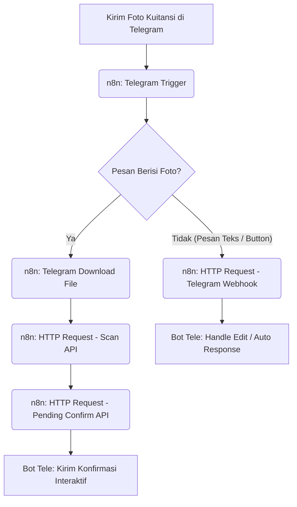

# 📷 Feature: Receipt Reader (OCR Ensemble)

The **Receipt Reader** is an advanced automation tool that digitizes physical receipts and digital transaction screenshots into the tracker using a **Voting Ensemble** of multiple OCR engines.

---

## 🏗️ Technical Architecture

The module is built on an **Ensemble Learning** philosophy:
- **`ocr_ensemble.py`**: The orchestrator that runs engines in parallel (or sequential) and aggregates results.
- **`parser.py`**: A complex regex-based heuristic engine for identifying Merchants, Totals, and Dates.
- **`categorizer.py`**: A semantic matcher that assigns categories based on keywords and historical memory.

---

## 🧩 Deep Dive: Core Logic

### 1. Voting Mechanism (Ensemble)
To mitigate the errors inherent in any single OCR engine, the system runs:
- **Tesseract**: Best for structured tables and clean text.
- **EasyOCR**: Superior for "noisy" or stylized backgrounds.
- **PaddleOCR**: Highly accurate for complex layouts.

**The Consensus Logic:**
- If 2 out of 3 engines agree on a numerical value (e.g., the Total Amount), that value is accepted.
- If no consensus, the system defaults to the engine with the highest confidence score.

### 2. Merchant Memory Bridge
The `merchant_map.db` acts as a local "brain." If you once categorized "GJK* 12345" as **Transport**, the system remembers this mapping for all future scans, automating categorization.

---

## 📊 Workflow Flow
1. **Input**: User provides a `.jpg`, `.png`, or `.pdf`.
2. **Scan**: Ensemble runs and produces a unified text stream.
3. **Parse**: Heuristics extract `date`, `total_amount`, and `merchant`.
4. **Classify**: Categorizer assigns one of the 8 standard categories.
5. **Review**: User confirms/edits the data before it hits `expense.db` or `income.db`.

---

## 🔗 Telegram & n8n Automation Workflow

You can automate receipt scanning by forwarding images directly from Telegram. The pipeline uses **n8n** as the orchestrator to download the image, call the Alpha OCR Scan API, and send the parsed result to the pending confirmation webhook.

A pre-built n8n workflow configuration is available here: [n8n_telegram_workflow.json](file:///c:/Users/Zhvn/Documents/Zhvny/Project/finance-tracker/docs/features/n8n_telegram_workflow.json).

### 🏗️ Integration Architecture


---

## 📘 Tutorial Penggunaan Bot Telegram (n8n)

### ⚙️ Step-by-Step Setup

1. **Buat Bot Telegram**:
   - Cari `@BotFather` di Telegram.
   - Ketik `/newbot` dan ikuti langkahnya untuk membuat bot baru.
   - Simpan **API Token** yang diberikan (contoh: `1234567890:AAEXAMPLE-DO-NOT-USE`).

2. **Konfigurasi Environment Server**:
   - Buka file `packages/api/.env` pada project Anda.
   - Set variabel `TELEGRAM_BOT_TOKEN` dengan token bot Anda:
     ```env
     TELEGRAM_BOT_TOKEN=<your-telegram-bot-token-here>
     ```
   - Restart API Server Anda.

3. **Import Workflow ke n8n**:
   - Buka n8n dashboard Anda.
   - Klik **Add workflow** -> **Import from file**.
   - Pilih file `n8n_telegram_workflow.json` dari folder `docs/features/`.

4. **Konfigurasi Node di n8n**:
   - **Telegram Trigger**: Tambahkan kredensial bot Telegram Anda (menggunakan token di atas). Pastikan opsi Trigger di-set untuk menerima update `message` dan `callback_query`.
   - **Telegram Download File**: Gunakan kredensial Telegram yang sama.
   - **HTTP Request - Scan API**:
     - Ubah domain `<IP_SERVER_ALPHA>` menjadi IP Server API Anda (contoh: `100.115.74.113` atau `localhost`).
     - Port default: `8444`.
     - URL: `https://<IP_SERVER_API>:8444/api/receipt/scan`.
     - Jika menggunakan SSL lokal self-signed, pastikan centang opsi **Ignore SSL Issues** di bawah setting node.
   - **HTTP Request - Pending Confirm API**:
     - Ubah domain `<IP_SERVER_ALPHA>` menjadi IP Server API Anda.
     - URL: `https://<IP_SERVER_API>:8444/telegram/receipt_pending`.
   - **HTTP Request - Telegram Webhook**:
     - Ubah domain `<IP_SERVER_ALPHA>` menjadi IP Server API Anda.
     - URL: `https://<IP_SERVER_API>:8444/telegram/webhook`.
   - Aktifkan Workflow di n8n (klik toggle **Active** di kanan atas).

---

## 📱 Panduan Interaksi dengan Bot

### 1. Pesan Teks Biasa (Auto-Response)
Jika Anda mengirimkan pesan teks seperti `hai`, `halo`, atau pesan lainnya:
- Bot **tidak akan mencatat** pesan tersebut ke database.
- Bot akan secara otomatis merespons dengan pesan bantuan/panduan cara mengirim foto struk.

### 2. Kirim Foto Struk (OCR Scan)
Kirim foto struk belanja Anda langsung ke bot:
- Bot akan merespons dengan status progress: `Mengunduh gambar...` -> `Menjalankan OCR...` -> `Menganalisis struk...`.
- Setelah selesai, bot akan memunculkan menu **Konfirmasi Struk Belanja** interaktif seperti berikut:
  
  ```text
  📝 Konfirmasi Struk Belanja
  
  • Merchant: Indomaret
  • Total: Rp 55.000
  • Kategori: shopping
  • Tanggal: 2026-07-20
  • Tipe: Pengeluaran
  
  Periksa detail di atas. Klik tombol di bawah untuk mengedit atau menyimpan.
  ```

### 3. Mengedit Isi Struk Secara Interaktif
Anda dapat mengubah detail struk yang kurang tepat hasil scan OCR sebelum menyimpannya:
- Klik tombol **📝 Edit Merchant**, **💰 Edit Total**, atau **📅 Edit Tanggal**:
  - Teks konfirmasi akan berubah meminta Anda mengetik nilai yang baru.
  - Ketik nilainya di chat (contoh: `Alfamart` atau `65000` atau `2026-07-19`) dan kirim.
  - Bot akan langsung memperbarui tampilan konfirmasi dengan data yang baru secara real-time.
- Klik tombol **🏷️ Edit Kategori**:
  - Bot akan menampilkan daftar kategori yang tersedia dalam bentuk tombol inline.
  - Klik salah satu kategori (contoh: `Food 🍔` atau `Transport 🚗`) untuk langsung mengubah kategorinya.
- Jika berubah pikiran saat sedang mengetik edit, klik tombol **⬅️ Batal Edit** untuk kembali ke menu konfirmasi utama.

### 4. Menyimpan atau Membatalkan
- **✅ Simpan / Konfirmasi**: Klik tombol ini jika data sudah benar. Bot akan mengekspor data transaksi langsung ke database `expense.db` atau `income.db` dan mengubah tampilan pesan menjadi sukses tersimpan.
- **❌ Batal**: Klik tombol ini untuk membatalkan pencatatan. Sesi akan dihapus dan keyboard interaktif akan dihilangkan.

---
*Terakhir Diperbarui: 20-07-2026 (03:18)*
