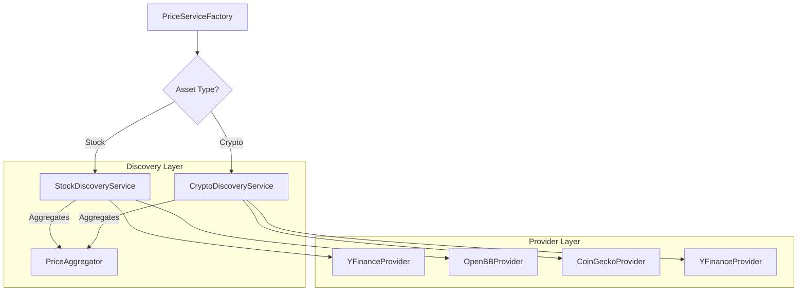

Last Updated: 29-05-2026 (14:30)

---
title: "Multi-Provider Price Discovery Engine"
created: "2026-05-23T23:30:00Z"
status: "approved"
authors: ["TechLead", "User"]
type: "design"
design_depth: "deep"
task_complexity: "medium"
---

# Multi-Provider Price Discovery Engine Design

## Problem Statement
Current price fetching in `finance-tracker` relies on single-provider services (e.g., `StockPriceService` uses only `yfinance`). This creates a single point of failure and risk of data inaccuracy if a provider has stale or incorrect data.

## Requirements

### Functional Requirements
1.  **REQ-1 (Multi-Provider Fetching)**: Support multiple data sources per asset type (e.g., Stocks: YFinance, OpenBB; Crypto: CoinGecko, YFinance).
2.  **REQ-2 (Aggregated Discovery)**: Calculate a single "Discovery Price" by averaging valid results from multiple providers.
3.  **REQ-3 (Outlier Detection)**: Automatically exclude prices that deviate more than 5% from the median when 3+ providers are available.
4.  **REQ-4 (Confidence Scoring)**: Provide a confidence metric (High/Medium/Low) based on provider count and price variance.
5.  **REQ-5 (Async Execution)**: Fetch data from all providers in parallel to minimize latency.

### Non-Functional Requirements
1.  **Resilience**: Graceful fallback to a single provider if others fail.
2.  **Extensibility**: Easy to add new `PriceProvider` implementations.
3.  **Auditability**: Log individual provider results for transparency.

## Architecture

### Component Map

### Key Components

1.  **`IPriceProvider` (Interface)**: Defines `get_price(ticker: str) -> Optional[float]`.
2.  **`PriceDiscoveryResult` (Data Class)**:
    *   `price`: float (The aggregated price)
    *   `confidence`: str (High/Medium/Low)
    *   `sources`: Dict[str, float] (Price per provider)
    *   `timestamp`: datetime
3.  **`DiscoveryService` (Base)**:
    *   Handles parallel execution.
    *   Implements `_calculate_discovery_price(prices: List[float])`.

### Aggregation Logic
1.  **Fetch**: Execute all registered providers for the asset type in parallel.
2.  **Filter**: Remove `None` and `0` values.
3.  **Outlier Logic**:
    *   If `count >= 3`: Calculate `median`. Exclude any price where `abs(price - median) / median > 0.05`.
4.  **Average**: Calculate mean of remaining prices.
5.  **Score**:
    *   **High**: 3+ providers, variance < 1%.
    *   **Medium**: 2 providers OR (3+ providers, variance 1-5%).
    *   **Low**: 1 provider OR variance > 5%.

## Implementation Plan (Draft)
1.  **Core Extension**: Add `IPriceProvider` to `packages/core/src/domain/repositories`.
2.  **Provider Migration**: Refactor existing services into `Providers`.
3.  **Aggregator Logic**: Implement `DiscoveryService` logic.
4.  **Factory Update**: Update `PriceServiceFactory` to return `DiscoveryService` instances.

## Risk Assessment
*   **Latency**: Parallel fetching might be throttled by APIs. *Mitigation: Strict timeouts (5s) per provider.*
*   **Ticker Mapping**: Different providers might use different symbols. *Mitigation: Re-use existing `SymbolFormatter` logic.*

## Success Criteria
1.  Price requests hit multiple sources successfully.
2.  One failing provider doesn't break the price fetch.
3.  Outliers are successfully ignored in tests.
