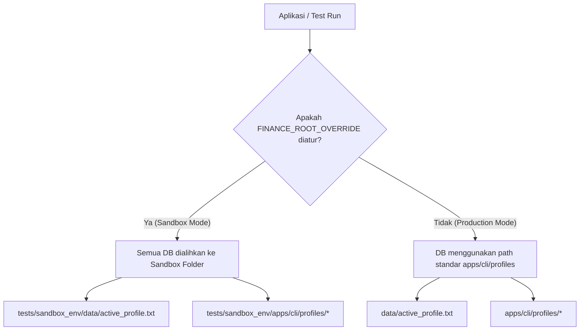

# 🗺️ Master QA Testing Strategy & Plan (Maestro Orchestration)
**Edisi Premium: Sandbox, Category-Partition, TDD, Secure SDLC, & Resilience**  
**Terakhir Diperbarui:** 24-06-2026 (13:45)  
**Target Monorepo:** Finance Tracker (CLI & API)

---

## 🎯 1. Pendahuluan & Kebijakan Nol Dampak Data Riil

Dokumen ini mendefinisikan strategi pengujian menyeluruh untuk memastikan keandalan matematis, isolasi data profil (Personal vs. Business), keamanan sistem, dan toleransi kegagalan pada Finance Tracker.

### 🛡️ Prinsip Keamanan Data Riil (Zero-Impact Policy)
Pengujian **TIDAK BOLEH** mengubah, memodifikasi, atau membaca database riil milik pengguna di production. Untuk mencapai hal ini, sistem monorepo telah dilengkapi dengan mekanisme isolasi tingkat lanjut (sandboxing).



### ⚙️ Implementasi Lingkungan Pengujian (Testing Environment)
1. **Isolasi Konfigurasi Core (`config.py`)**:
   Kami mengimplementasikan deteksi variabel lingkungan `FINANCE_ROOT_OVERRIDE`. Jika diatur, `Config.BASE_DIR` dialihkan sepenuhnya to folder sandbox. Metode `get_cli_data_root` akan mengabaikan variabel `FINANCE_DATA_ROOT` global guna mencegah kebocoran data (leakage).
   
2. **Isolasi Otomatis Test Suite (`conftest.py`)**:
   Setiap pengujian unit/integrasi yang dijalankan via `pytest` secara otomatis diisolasi menggunakan fixture `isolate_test_environment`. Fixture ini membuat direktori sementara (`tmp_path`) unik untuk setiap test case, mengatur `FINANCE_ROOT_OVERRIDE`, dan me-reset cache `Config`.
   
3. **Sandbox CLI Interaktif (`tests/run_sandbox_cli.py`)**:
   Untuk pengujian manual yang aman, telah dibuat script launcher interaktif. Pengembang dapat menjalankan:
   ```bash
   python tests/run_sandbox_cli.py --clean
   ```
   Script ini menyalin skema `.env`, mengaktifkan override, dan membuka menu CLI utama menggunakan database kosong di folder `tests/sandbox_env/` tanpa menyentuh data riil.

---

## 📊 2. Prinsip Category-Partition Method

Prinsip **Category-Partition Method** memecah domain input dari setiap fungsi penting ke dalam kategori karakteristik, lalu membaginya menjadi partisi nilai (valid & invalid) untuk meminimalkan redundansi tes namun tetap menjaga cakupan (coverage) yang maksimal.

### 2.1 Alur Transaksi Investasi (FIFO Buy/Sell)
*   **Kategori: Security Ticker**
    *   *Partisi Valid:* US Stock (e.g. `AAPL`), Crypto (e.g. `BTCUSD`).
    *   *Partisi Invalid:* String kosong (`""`), ticker terlalu panjang (`"VERYLONGTICKER"`), karakter khusus (`"AAP$L"`).
*   **Kategori: Tipe Transaksi (Buy/Sell)**
    *   *Partisi Valid:* `buy`, `sell`.
    *   *Partisi Invalid:* `hold`, `short`, `dividend` (jika belum didukung).
*   **Kategori: Kuantitas Jual (FIFO Matching)**
    *   *Partisi Valid (Partial Sell):* Kuantitas < total unit holding lot tertua.
    *   *Partisi Valid (Full Sell):* Kuantitas == total unit holding seluruh lot.
    *   *Partisi Invalid (Oversell/Short):* Kuantitas > total holding yang tersedia.
    *   *Partisi Invalid (Non-positif):* Kuantitas `0`, kuantitas negatif (`-5`).

### 2.2 Alur Pencatatan Pengeluaran & Budgeting
*   **Kategori: Nominal Pengeluaran (Amount)**
    *   *Partisi Valid:* Angka positif integer (`10000`), desimal desimal (`150.50`).
    *   *Partisi Invalid:* `0`, negatif (`-100`), string non-numerik (`"sepuluh ribu"`).
*   **Kategori: Kategori Anggaran (Category)**
    *   *Partisi Valid:* Kategori terdaftar (`Food`, `Transport`, `Bills`).
    *   *Partisi Invalid (Unregistered):* Kategori kosong, kategori di luar skema tanpa fallback.

---

## 📋 3. Matriks Kasus Uji (Valid & Invalid Test Cases)

| ID Kasus | Modul | Deskripsi Pengujian | Input Inputted | Hasil yang Diharapkan | Tipe Tes |
| :--- | :--- | :--- | :--- | :--- | :--- |
| **TC-01** | Profiling | Ganti profil yang valid | `8` -> `1` -> `Business` | Profil aktif bergeser ke Business, DB dimuat ulang dengan aman. | **Valid** |
| **TC-02** | Profiling | Tambah profil dengan nama terlarang | `8` -> `2` -> `profile!@#` | Sistem menolak dengan pesan error validasi karakter. | **Invalid** |
| **TC-03** | Income | Tambah Pemasukan valid | `3` -> `1` -> `Gaji` -> `15000000` -> `y` | Saldo bertambah tepat Rp15.000.000, tercatat di `audit_log.db`. | **Valid** |
| **TC-04** | Income | Tambah Pemasukan dengan nominal negatif | `3` -> `1` -> `Gaji` -> `-500000` | Input ditolak, prompt meminta masukkan nominal positif kembali. | **Invalid** |
| **TC-05** | Investment| Beli saham (Buy Lot) | `1` -> `1` -> `AAPL` -> `us` -> `150` -> `10` -> `y` | Terbuat lot investasi baru dengan harga $150 sebanyak 10 unit. | **Valid** |
| **TC-06** | Investment| FIFO Sell - Partial Sell | `1` -> `7` -> `AAPL` -> `6` -> `160` | Mengurangi 6 unit dari lot pertama ($150), menyisakan 4 unit di lot tersebut. Realized P/L: +$60. | **Valid** |
| **TC-07** | Investment| FIFO Sell - Oversell | `1` -> `7` -> `AAPL` -> `100` -> `160` | Transaksi ditolak karena unit holding yang tersedia tidak mencukupi. | **Invalid** |
| **TC-08** | OCR Scanner| Scan struk belanja valid | `4` -> `1` -> `tests/fixtures/receipt.jpg` | Merchant, tanggal, dan total nominal berhasil diurai oleh OCR ensemble. | **Valid** |
| **TC-09** | OCR Scanner| Scan berkas gambar fiktif / path salah | `4` -> `1` -> `non_existent_file.png` | Deteksi berkas gagal, dilempar peringatan aman tanpa menyebabkan CLI crash. | **Invalid** |

---

## 🔄 4. Metodologi TDD (Red-Green-Refactor)

Semua perbaikan bug matematis atau fitur baru harus mengikuti siklus TDD yang ketat:

```
[RED: Tulis tes yang gagal] ➔ [GREEN: Tulis kode minimal agar tes lolos] ➔ [REFACTOR: Bersihkan kode tanpa merusak tes]
```

### Panduan Implementasi TDD (Studi Kasus: Perhitungan Pajak PPh 21 Progresif)
1.  **Red Stage (Menulis Tes Gagal)**:
    Tulis fungsi uji di `tests/unit/test_financial_math_invariants.py` sebelum mengimplementasikan logika tarif progresif baru 35% untuk penghasilan di atas Rp5M per tahun.
    ```python
    def test_pph21_progressive_highest_bracket():
        # PKP = 6.000.000.000 (6 Miliar)
        # Ekspektasi PPh 21 menggunakan simulasi tarif progresif UU HPP
        expected_tax = calculate_expected_tax(6000000000)
        assert calculate_pph21(pkp=6000000000) == expected_tax
    ```
    *Jalankan pytest, tes dipastikan gagal (Red) karena fungsi belum mengimplementasikan bracket tertinggi.*

2.  **Green Stage (Menulis Kode Minimal)**:
    Tulis logika minimal pada modul kalkulator pajak agar tes di atas lolos (Green).
    ```python
    def calculate_pph21(pkp: float) -> float:
        # Tulis perhitungan bracket progresif (5%, 15%, 25%, 30%, 35%) secara berurutan.
        # ...
        return total_tax
    ```
    *Jalankan pytest, tes lolos (Green).*

3.  **Refactor Stage (Optimalisasi Kode)**:
    Bersihkan perulangan kondisi bracket desimal menjadi representasi array konfigurasi agar lebih mudah dirawat tanpa mengubah perilaku luar.
    *Jalankan kembali pytest untuk memastikan regresi tidak terjadi.*

---

## 🛡️ 5. Keamanan Sistem (Vulnerabilities and Threats)

Sektor keuangan sangat sensitif terhadap eksploitasi data. Berikut adalah ancaman (Threats) yang dianalisis beserta mitigasinya (Vulnerabilities Mitigation):

### 5.1 SQL Injection (SQLi)
*   **Ancaman:** SQLite yang digunakan pada repositori rentan terhadap injeksi query jika input pengguna langsung dimasukkan ke perintah SQL (`string formatting`).
*   **Mitigasi:** Melarang keras string interpolasi (`f"SELECT ... WHERE id = {user_id}"`). Semua interaksi SQLite wajib menggunakan parameterized query (`execute("SELECT ... WHERE id = ?", (user_id,))`).

### 5.2 Kebocoran Data Antar-Profil (Profile Data Leakage)
*   **Ancaman:** SQLite databases untuk Personal dan Business disimpan berdampingan. Ada risiko thread atau sesi CLI salah membaca database profil lain, melanggar prinsip isolasi fisik.
*   **Mitigasi:** `Config.get_cli_data_root()` secara dinamis mengambil path database berdasarkan profil aktif yang divalidasi. Shared database (`goals.db`) menerapkan filter Profile-IDs (Row-Level Security) yang dipaksakan pada tingkat repository class.

### 5.3 Modifikasi Histori Keuangan Tanpa Izin (Data Tampering)
*   **Ancaman:** Pengguna atau pihak luar mengedit file database SQLite secara langsung menggunakan editor eksternal untuk memanipulasi riwayat saldo atau transaksi.
*   **Mitigasi:** Setiap penulisan transaksi mencatat salinan hash kriptografis SHA-256 HMAC (menggunakan `ENCRYPTION_KEY` dari `.env`) ke dalam `audit_log.db`. Pada saat aplikasi melakukan boot/startup, hash seluruh transaksi divalidasi silang. Jika ada kecocokan yang timpang, sistem akan memicu status "Security Alert" dan memblokir modifikasi lanjutan sampai dilakukan rekonsiliasi manual.

### 5.4 Path Traversal pada OCR Scan
*   **Ancaman:** User menginput path relatif manipulatif (`../../../../windows/win.ini`) pada fungsi pembaca struk untuk mendeteksi berkas sensitif OS.
*   **Mitigasi:** Path gambar divalidasi menggunakan helper untuk memastikan lokasinya berada di dalam subdirektori proyek atau folder sementara yang diizinkan sebelum diproses oleh Tesseract/EasyOCR.

---

## 🔄 6. Siklus Hidup Pengembangan Aman (Secure SDLC)

Keamanan terintegrasi dalam setiap langkah pengembangan (bukan sekadar audit akhir):

```
[Requirement & Threat Modeling] ➔ [Secure Coding & Code Review] ➔ [CI Pipeline SAST & Unit Testing] ➔ [Isolated Sandbox Run]
```

1.  **Tahap Requirements**: Pemodelan ancaman pada fitur baru (e.g. Butterfly macro pricing correlation API check).
2.  **Tahap Code Review**: Verifikasi kepatuhan arsitektur Clean Architecture dan pembatasan SQL Parameterization.
3.  **Tahap Integrasi (CI/CD Pipeline)**:
    *   **Pemeriksaan Linting & Formatting**: Menghapus `BOM` karakter pada berkas `.env` dan kode sumber.
    *   **Pemindaian Kredensial (Secret Scanning)**: Verifikasi tidak ada API Key yfinance atau token enkripsi yang bocor (hardcoded) di repositori git menggunakan alat bantu seperti `trufflehog` atau `git-secrets`.
    *   **SAST (Static Application Security Testing)**: Jalankan pemindaian kerentanan python otomatis:
        ```bash
        pip-audit
        bandit -r apps/cli/ packages/
        ```
    *   **Unit & Integration Test Automation**: Menjalankan seluruh tes terisolasi secara otomatis setiap ada Pull Request.

---

## 🔌 7. Teknik Toleransi Kesalahan (Fault Tolerance Techniques)

Aplikasi harus tetap tangguh dan tidak crash walau lingkungan luar mengalami kendala atau kegagalan.

### 7.1 Ketahanan Terhadap Kegagalan API Eksternal
*   **Kasus:** `yfinance` API offline saat memuat portofolio investasi saham, atau kuota OCR Cloud habis.
*   **Solusi:**
    1.  **Local Price Cache Fallback:** Jika yfinance gagal, sistem mengambil harga terakhir yang disimpan di database `market.db` / `price_snapshots` dan menampilkan peringatan visual "[dim](Offline Mode - Cached Price Used)[/dim]".
    2.  **OCR Graceful Downgrade:** Jika PaddleOCR/EasyOCR gagal memuat karena pustaka C++ rusak di mesin Windows pengguna, sistem secara otomatis menurunkan engine (graceful downgrade) ke Tesseract OCR, atau meminta input formulir manual secara ramah tanpa crash.

### 7.2 Masalah Konkurensi & Penguncian Database SQLite
*   **Kasus:** SQLite memicu `sqlite3.OperationalError: database is locked` saat thread background scheduler menulis status networth dan UI CLI melakukan pembacaan simultan.
*   **Solusi:**
    1.  **WAL Mode:** Mengaktifkan Write-Ahead Logging (WAL) pada SQLite connection initialization untuk mendukung operasi baca dan tulis secara paralel tanpa saling memblokir.
    2.  **Retries Connection Wrapper:** Membungkus eksekusi query dengan skema retry otomatis bermetode eksponensial backoff:
        ```python
        def execute_with_retry(conn, query, params=(), retries=5):
            for i in range(retries):
                try:
                    return conn.execute(query, params)
                except sqlite3.OperationalError as e:
                    if "locked" in str(e) and i < retries - 1:
                        time.sleep(0.1 * (2 ** i))
                        continue
                    raise
        ```

### 7.3 Penanganan Eksepsi CLI Menyeluruh (Global Crash Prevention)
*   **Kasus:** Input integer menu dimasukkan karakter string acak atau terputus secara mendadak (EOFError).
*   **Solusi:**
    *   Loop utama CLI di `apps/cli/main.py` dibungkus dengan blok `try...except KeyboardInterrupt` and `except EOFError` untuk keluar dari aplikasi secara bersih (Safe Exit), memastikan semua koneksi SQLite ditutup (`close()`) untuk mencegah kerusakan file `.db` (corruption).
    *   Input numerik disaring ketat menggunakan regex `^\d+$` sebelum dikonversi menjadi integer.

---

## 🤖 8. Mekanisme Pelacakan Progress & State AI Agent (Maestro Continuity)

Agar agen AI (seperti Antigravity/Gemini) dapat melanjutkan pekerjaan secara konsisten dari titik terakhir dan menghindari pengerjaan tugas secara redundan, sistem memanfaatkan mekanisme pelacakan *state* berikut:

### 8.1 Transkrip Konteks & Riwayat Percakapan
Setiap sesi pemanggilan agen menyertakan riwayat interaksi sebelumnya:
* **Transkrip Ringkas (`transcript.jsonl`)**: Digunakan untuk melacak garis besar langkah-langkah, pemanggilan subagent, dan *tool calls* utama.
* **Transkrip Lengkap (`transcript_full.jsonl`)**: Menyimpan seluruh detail output dan modifikasi kode untuk melacak perubahan secara presisi.
Kedua transkrip ini berada di direktori lokal `<appDataDir>\brain\<conversation-id>\.system_generated\logs`.

### 8.2 Dokumentasi Rencana & Artefak Proyek
Setiap pengerjaan tugas kompleks didasarkan pada dokumen perencanaan (*Master Plan* atau *Task List*) yang disimpan dalam folder artefak:
* Status tugas dipantau menggunakan tag status yang jelas seperti `TODO`, `IN_PROGRESS`, dan `DONE`.
* Sebelum memulai langkah baru, agen memvalidasi berkas ini untuk menentukan prioritas tugas berikutnya.

### 8.3 Inspeksi Workspace & Riwayat Git
Agen melakukan validasi fisik di dalam repositori sebelum mengeksekusi perubahan kode:
* Memeriksa status repositori (misalnya `git diff` atau `git status`) untuk mengetahui file mana saja yang telah disentuh.
* Melakukan pencarian menggunakan `grep_search` untuk memastikan fungsi atau modul target belum pernah diimplementasikan sebelumnya di bagian lain repositori.

### 8.4 Aturan Persisten Monorepo ([GEMINI.md](file:///C:/Users/Zhvn/Documents/Zhvny/Project/finance-tracker/GEMINI.md))
Semua standar proyek, keputusan arsitektur, dan status fase pengembangan dicatat secara persisten pada file [GEMINI.md](file:///C:/Users/Zhvn/Documents/Zhvny/Project/finance-tracker/GEMINI.md). File ini dibaca oleh agen pada awal pemanggilan untuk memastikan seluruh aksi tetap selaras dengan *Single Source of Truth* (SSOT) proyek.

---

## 🏃 9. Ringkasan Eksekusi Pengujian

Untuk memverifikasi sistem Anda siap diuji:
1.  **Jalankan Suite Tes Otomatis (Aman & Terisolasi):**
    ```bash
    pytest
    ```
2.  **Buka CLI Sandbox untuk Eksplorasi Manual:**
    ```bash
    python tests/run_sandbox_cli.py --clean
    ```

Sistem monorepo Finance Tracker Anda sekarang memiliki fondasi jaminan mutu (QA) kelas dunia yang melindungi integritas finansial pengguna dan fungsionalitas pengembang secara bersamaan.
