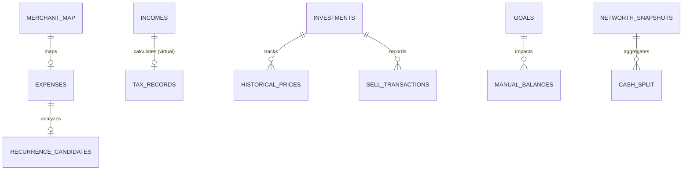

# Finance Tracker — Database Schema Documentation (v10.0)

This document serves as the **Technical Source of Truth** for the Finance Tracker persistence layer. The system uses a **Distributed SQLite Architecture**, where each domain module maintains its own specialized database to ensure modularity and data sovereignty.

---

## 1. High-Level ER Diagram

The following diagram illustrates the logical relationships across the distributed databases.

---

## 2. Core Tracking Databases (CLI)

### 2.1. Expense Tracker (`apps/cli/expense_tracker/data/expense.db`)
Stores all personal spending records and identifies recurring patterns.

**Table: `expenses`**
| Field | Type | Description |
| :--- | :--- | :--- |
| `id` | INTEGER (PK) | Unique identifier. |
| `amount` | REAL | Transaction value. |
| `description` | TEXT | Transaction memo/vendor. |
| `category` | TEXT | Budget category (e.g., food, transport). |
| `payment_method` | TEXT | e.g., cash, credit_card. |
| `date` | TEXT | ISO-8601 date. |
| `is_recurring` | BOOLEAN | Flag for subscription/regular bills. |
| `recurring_period`| TEXT | e.g., monthly, weekly. |
| `created_at` | TEXT | Record timestamp. |

**Table: `recurrence_candidates`**
| Field | Type | Description |
| :--- | :--- | :--- |
| `id` | INTEGER (PK) | Unique identifier. |
| `description` | TEXT | Common descriptor. |
| `category` | TEXT | Assigned category. |
| `avg_amount` | REAL | Mean value across occurrences. |
| `interval_days` | REAL | Calculated frequency. |
| `occurrences` | INTEGER | Frequency count. |
| `confidence` | REAL | Probability score (0.0 - 1.0). |
| `is_confirmed` | BOOLEAN | User-validated candidate. |

---

### 2.2. Income Tracker (`apps/cli/income_tracker/data/income.db`)
Tracks all revenue streams and tax eligibility.

**Table: `incomes`**
| Field | Type | Description |
| :--- | :--- | :--- |
| `id` | INTEGER (PK) | Unique identifier. |
| `amount` | REAL | Net amount received. |
| `source` | TEXT | Employer/Platform. |
| `income_type` | TEXT | e.g., salary, investment, freelance. |
| `date` | TEXT | ISO-8601 date. |
| `is_taxed` | BOOLEAN | Flag for progressive tax estimation. |

---

### 2.3. Investment Tracker (`apps/cli/investment_tracker/data/portfolio.db`)
Manages multi-asset portfolios with FIFO sell-down logic.

**Table: `investments`**
| Field | Type | Description |
| :--- | :--- | :--- |
| `id` | INTEGER (PK) | Unique identifier. |
| `asset_type` | TEXT | e.g., stock, crypto, gold. |
| `ticker` | TEXT | Symbol (e.g., BBCA.JK, BTC). |
| `quantity` | REAL | Total units purchased. |
| `buy_price` | REAL | Unit cost at purchase. |
| `status` | TEXT | `holding`, `partial_sold`, or `sold`. |
| `remaining_qty` | REAL | Units currently in possession. |

**Table: `sell_transactions`**
| Field | Type | Description |
| :--- | :--- | :--- |
| `id` | INTEGER (PK) | Unique identifier. |
| `investment_id` | INTEGER | FK to `investments.id`. |
| `sell_date` | TEXT | ISO-8601 date. |
| `quantity` | REAL | Units sold. |
| `sell_price` | REAL | Unit price at sale. |
| `realized_pl_idr`| REAL | Net profit/loss in local currency. |
| `realized_pl_pct`| REAL | P/L percentage. |

---

## 3. Intelligence & Analytics

### 3.1. Stock Analyzer (`finance-tracker-gui/cache.db`)
High-performance OHLCV data store for quant analysis.

**Table: `ohlcv_cache`**
| Field | Type | Description |
| :--- | :--- | :--- |
| `ticker` | TEXT (PK) | Stock/Asset symbol. |
| `period` | TEXT (PK) | Timeframe (e.g., 1y, 5y). |
| `fetched_at` | REAL | Epoch timestamp of fetch. |
| `data` | BLOB | Compressed binary candle data. |

---

## 4. GUI & System Management

### 4.1. Audit & Security (`finance-tracker-gui/data/audit_log.db`)
Centralized logging for API and system interactions.

**Table: `audit_log`**
| Field | Type | Description |
| :--- | :--- | :--- |
| `id` | INTEGER (PK) | Unique identifier. |
| `ts` | TEXT | Timestamp. |
| `ip` | TEXT | Requester IP. |
| `method` | TEXT | HTTP Method (GET/POST/etc). |
| `path` | TEXT | API Endpoint. |
| `status_code` | INTEGER | HTTP status code. |
| `latency_ms` | REAL | Processing time. |

---

### 4.2. Net Worth History (`finance-tracker-gui/data/networth_history.db`)
Daily snapshots for long-term trend visualization.

**Table: `networth_snapshots`**
| Field | Type | Description |
| :--- | :--- | :--- |
| `date` | TEXT (PK) | ISO-8601 date. |
| `total_networth`| REAL | Sum of all assets - liabilities. |
| `cash` | REAL | Physical/Bank liquid cash. |
| `crypto` | REAL | Total crypto value in IDR. |
| `stocks` | REAL | Total stock value in IDR. |
| `gold` | REAL | Total gold value in IDR. |

---

## 5. Planned Schema Additions (v11.0 Roadmap)

### 5.1. Risk Management Module (`risk_mgmt.db`)
*   **Table: `var_results`**: Value at Risk (VaR) history for portfolio stress testing.
*   **Table: `correlation_matrix`**: Cross-asset correlation coefficients to detect concentration risk.

### 5.2. Social & Sharing (`sharing_state.db`)
*   **Table: `shared_reports`**: Metadata for generated HTML/PDF reports shared via the Remote Dashboard.
*   **Table: `access_tokens`**: Time-limited tokens for external view-only access.

---

## 6. Data Integrity Mandates

1.  **Immutability**: Historical transaction records (`expenses`, `incomes`, `sell_transactions`) must never be updated once committed. Adjustments must be handled via reversal/correction entries.
2.  **Referential Integrity**: Although SQLite supports foreign keys, many cross-database "links" are logical (handled by the `application` layer). Developers must ensure cross-DB consistency manually or via the `api_server.py` orchestration layer.
3.  **Atomic Commits**: Use transactions for multi-row operations, especially in FIFO sell logic where `investments` and `sell_transactions` are updated concurrently.

---
07-05-2026 (22:35)
